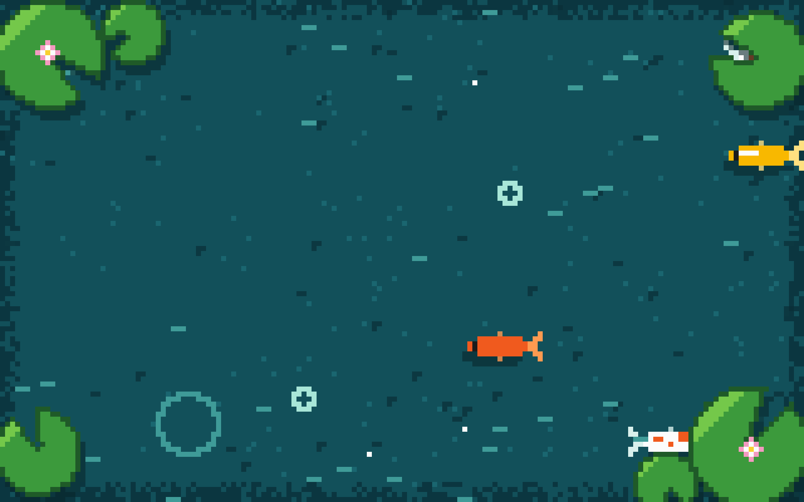

# Claude
Claude background: an animated 8-bit koi pond.

Pixel-art koi swim back and forth beneath lily pads and lotus flowers, with
ripples spreading and sparkles blinking on the water.



## Claude app background

The `koi-pond-8bit` plugin sets the pond as the animated background (and a
matching teal color scheme) in the Claude desktop and mobile apps for Claude
Code sessions. The terminal does not draw backgrounds.

Install it at the prompt of a Claude Code session:

```
/plugin install koi-pond-8bit --marketplace sklly09/claude
```

Answer `y` to add the marketplace, then pick a scope. From a shell:

```
claude plugin install koi-pond-8bit --marketplace sklly09/claude
```

## Wallpapers

| File | For |
| --- | --- |
| `wallpapers/koi-pond-8bit-iphone.mp4` | iPhone, animated 24-second loop (1080×2340) |
| `wallpapers/koi-pond-8bit-iphone.png` | iPhone, still |
| `wallpapers/koi-pond-8bit-mac.mp4` | Mac, animated loop (1920×1200) |
| `wallpapers/koi-pond-8bit-mac.html` | Mac, live-animated page for a web-wallpaper app such as Plash |
| `wallpapers/koi-pond-8bit-mac.png` | Mac, still |

**iPhone:** for a still, save the PNG to Photos and choose it in Settings →
Wallpaper. For motion, convert the MP4 to a Live Photo with an app such as
intoLive, then choose it in Settings → Wallpaper.

**Mac:** for a still, use System Settings → Wallpaper → Add Photo. For motion,
open the HTML file in a web-wallpaper app such as Plash, or the MP4 in a
video-wallpaper app.

## Regenerating

`tools/make_scene.py <out dir>` writes the scene SVGs; `tools/render_frames.js`
renders them frame by frame with Playwright for encoding with ffmpeg.
